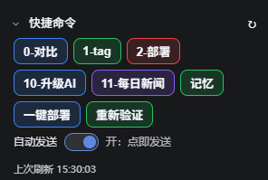

# openchamber-shortcuts

OpenChamber 快捷按钮：点即把常用命令/片段提交到当前会话。只有工作状态分区，没有独立大面板。

## 截图



## 界面

- 快捷按钮：单个按钮只显示描述（如 `0-对比`），不显示英文名；按描述数字感知排序。
- 自动发送：底部胶囊开关，开=点即自动发送，关=只填入输入框；`localStorage` 持久化，默认开。
- `↻`：重读片段与命令配置，重绘后结果行回执（`已重读：N 个快捷`）；老宿主不支持标题栏控件时退回区内按钮。
- `上次刷新 HH:MM:SS`：与 Git 分区同样式；操作回执在它下方，失败标红。

## 按钮来源（插件只读不管理）

| 来源 | 路径 | 显示 | 发出 |
| ---- | ---- | ---- | ---- |
| 片段库 | `~/.config/opencode/snippet/*.md` | frontmatter `description` | 正文 |
| 全局命令 | `~/.config/opencode/command\|commands/*.md` | `description`，无则文件名 | `/name` |
| 项目命令 | `command/\|commands/\|.opencode/command\|commands/*.md` | 同上 | `/name` |
| 起草器 | 本仓 `.openchamber/project.json` 的 `draftStarters` | 能对上描述就显示，否则显示名 | `/name` |

示例：`snippet/ci.md` 头部 `description: 0-对比` → 按钮显示 `0-对比`，点击发送正文。

用法要点：管理去各自位置（片段/命令改 md 文件，起草器去设置→项目）；全都没有就显示 `暂无快捷`。

## 数据结构

| 字段 | 类型 | 说明 |
| ---- | ---- | ---- |
| `label` | `string` | 按钮显示（描述） |
| `text` | `string` | 点击发送内容（正文或 `/name`） |

## 安装

设置 → 扩展 → 粘贴 Git 地址添加：

```text
https://github.com/xcvsfsd/openchamber-shortcuts
```

本地开发可用文件夹路径安装（`/home/liaoz/code/openchamber-shortcuts`）。

批准 `prompt` + `files` + `filesystem`（读片段与配置）能力。Work Status 节列表里打开「快捷命令」拖到 Git 下面。

## 说明

- `openchamber.contributes.panel` 保留 `id`/`name`/`icon`，省略 `entry`：扩展只有状态区、没有 rail 面板。整块删掉会让宿主解析 manifest 失败（`missing-panel`），扩展会从列表消失。
- 状态区每 30 秒自动重读一次片段/命令，切项目时立即重读。

## 开发/发版

```bash
bun run typecheck
bun run build
```

改完 `bun run build`，升 `package.json` version，提交 built 文件（`status/main.js` + `status/index.html` 必须提交，宿主不构建）。

## License

MIT
